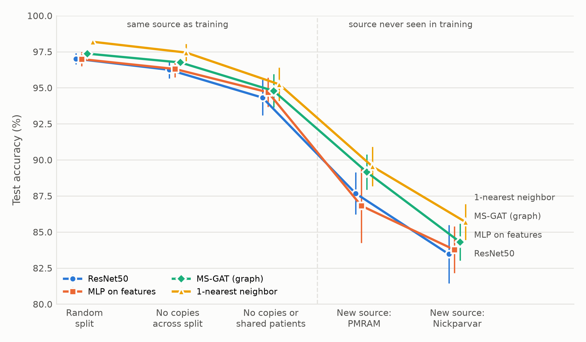

# How much of a brain tumor classifier's 99% accuracy is real?

Code and results for the paper by Kairav Sapru (Tesla STEM High School), mentored by Dr. Shresth Gupta (University of Surrey).

Many papers report about 99% accuracy for classifying brain tumor MRI scans on public Kaggle datasets. We built a tool that finds copied images (including rotated and mirrored copies) and recovered patient IDs, then re-scored the same models under stricter and stricter tests.



## Main findings

- **Most "test" images are not new.** 66.9% of the official Nickparvar test images have a near-copy in its training folder; counting shared patients, 87.9% do. 75.2% of BRISC 2025 and 54.8% of PMRAM, often used as "external" test sets, have near-copies in Nickparvar's training folder.
- **Accuracy falls at every stricter step.** The same four models drop from about 97 to 98% on a random split to 94 to 95% with no shared copies or patients, and to 83 to 90% on an image source never seen in training (5 seeds each).
- **Leakage changes which model looks best.** A 1-nearest-neighbor lookup scores highest on leaky splits. With frozen DINOv2 features it falls 12.2 points (95.6% to 83.4%) once copies and patients are separated, the largest drop of any model. The graph model's edge over a plain MLP disappears on the patient split.
- **Published recipes, rebuilt.** Rebuilt from their papers, two published ~99% pipelines reached 95.6% (ResNet50) and 94.9% (VGG16) on their original-style splits, and 93.8% and 88.9% on copy- and patient-free splits.
- **Rotated copies matter.** 1,110 cross-dataset copies only match after a 180-degree rotation, which flip-only checks miss.

## Check your own dataset

```
pip install pillow imagehash numpy
python leakcheck/leakcheck.py train=data/Training test=data/Testing --out report/
```

See [`leakcheck/README.md`](leakcheck/README.md).

## What is in this repo

| Path | What it is |
|---|---|
| `notebooks/MSGAT_v5_kaggle.ipynb` | Full study in one notebook, built to run overnight on Kaggle (about 3.5 to 4.5 hours on a T4 GPU) |
| `notebooks/Brain_Tumor_MultiScale_GAT_v4_corrected.ipynb` | The Colab notebook behind the current paper draft, with its outputs |
| `results/v4/` | Result files from the v4 run (`msgat_results.json`, `lodo_results.csv`, `near_duplicate_counts.csv`) |
| `notebooks/MSGAT_v5b_patient_kaggle.ipynb` | Same notebook, set to run only the patient-level split (Parts A and C) |
| `results/v5/` | Result files from the v5 Kaggle run (`msgat_v5_results.zip` unpacked): random and near-copy-free group splits, ablation, seeds, leave-one-source-out, size control |
| `results/v5b/` | Result files from the patient-level run (5 seeds) |
| `leakcheck/` | Stand-alone tool that finds copies, including rotated and mirrored ones, across folders or datasets |
| `v6/` | Leak-aware split table (`splits_v6.csv`, built by `build_splits.py`) and the re-test of two published recipes plus frozen DINOv2 features (`msgat_v6_retest.ipynb`) |
| `results/v6/` | v6 results: `part1_dino.csv` (DINOv2, 5 seeds x 4 splits x 4 classifiers) and `part2_recipes.csv` (published recipes) |
| `figures/` | `make_ladder.py` and the accuracy ladder figure |

## Data

The images are not included here. Each dataset keeps its own license, so download them from the original pages:

| Name in the code | Dataset | Link |
|---|---|---|
| `MRI.zip` (ds1) | M. Nickparvar, Brain Tumor MRI Dataset, Kaggle, version 2 (7,200 images) | https://doi.org/10.34740/KAGGLE/DSV/2645886 |
| `archive.zip` (ds2) | BRISC 2025 (6,000 classification images) | https://doi.org/10.17632/c7dj4pwhcv.1 |
| PMRAM (ds3) | PMRAM Bangladeshi Brain Cancer MRI Dataset, Raw Data folder only | https://doi.org/10.17632/m7w55sw88b.1 |
| Figshare (patient IDs only) | J. Cheng, brain tumor dataset (3,064 slices, 233 patients); used only to recover patient IDs, never trained on | https://figshare.com/articles/dataset/brain_tumor_dataset/1512427 |

PMRAM's Augmented Data folder holds flipped and rotated copies of the raw scans. The notebooks never load it, because those copies would leak test images into training.

## How to rerun on Kaggle

1. Create a private Kaggle dataset and upload the three zips: `MRI.zip`, `archive.zip`, and `PMRAM Bangladeshi Brain Cancer - MRI Dataset.zip`. Optionally add the four Figshare zips (`brainTumorDataPublic_*.zip`) to enable the patient-level split, or attach the public Kaggle copy of the same files (`ashkhagan/figshare-brain-tumor-dataset`) with **Add Input**.
2. Import `notebooks/MSGAT_v5_kaggle.ipynb` as a new Kaggle notebook and attach that dataset with **Add Input**.
3. In the notebook settings, set **Accelerator** to GPU T4 and turn **Internet** on.
4. Click **Save Version**, then **Save & Run All (Commit)**. It keeps running after you close the tab.
5. When it finishes, download `msgat_v5_results.zip` from the version's **Output** tab.

The first data cell checks the image counts (7,200, 6,000, and about 1,505) and stops right away with a folder listing if something is off.

## What the v5 notebook runs

- **Deduplication.** Exact 256-bit perceptual-hash matches are removed. Images whose hashes are within 4 bits of each other, counting flipped versions, are grouped as near-copies.
- **Patient IDs (optional).** Tumor images are matched to the Figshare dataset (normalized cross-correlation of at least 0.95 on 64x64 thumbnails, all 8 rotations and flips) to recover patient IDs.
- **Part A.** The main comparison on a random split, on a group split where no near-copy group crosses train and test, and on a patient split that also keeps each Figshare patient on one side.
- **Part B.** Ablation: neighbor count k, graph mode, class weights, CLAHE, single-scale features, and a GCN instead of the GAT.
- **Part C.** Five seeds on every split for every model.
- **Part D.** Leave-one-source-out over five seeds, with per-image predictions so each held-out source can be scored with and without its cross-source near-copies.
- **Part E.** A control for the MRI.zip fold that matches its training size and class mix, using images from all sources.

## Requirements

Python 3.10+, PyTorch 2.x, torchvision, PyTorch Geometric, scikit-learn, SciPy, pandas, OpenCV, imagehash, and grad-cam (optional, only for the Grad-CAM figure). The Kaggle notebook installs the last three itself.

## License

Code: MIT License. The datasets are not covered by this license.
